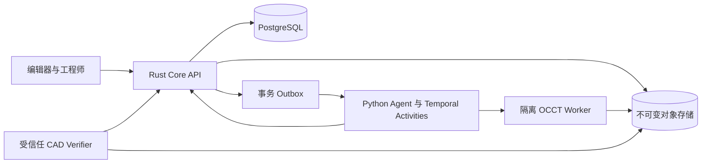

# 工业精密 CAD Agent：开发基线 v0.1

后续权威更新：本文件保留早期设计背景；当前目标和边界以 [目标状态契约 v1.0](target-contract-v1.md)、[系统设计 v1.0](system-design-v1.md) 为准。实际实现见 [当前状态](current-state.md) 和 [0.3.0 CAD 能力](cad-capabilities.md)。下文的 Temporal、部署形态和里程碑顺序是当时方案，不是已经部署或必须绑定的实现。

日期：2026-10-26；实施更新：2026-10-27。状态：开发基线，已实现首版本地 Rust 工程内核和 OCCT 法兰执行/验证；各阶段状态以实施记录为准。完整工业资格尚未建立。

本基线依据用户确认的“精密 CAD：B-Rep + OCCT，导出 STEP”和“工业级别”收敛原 RFC-001～005。它替换原稿互相冲突的首版范围及优先级；原稿继续作为设计背景。

2026-10-27 模型更新：[系统数学模型 v0.2](mathematical-model.md)重新定义工程规范、几何求值、验收、任务、执行权与恢复的关系，作为后续领域建模依据；实现状态见 [持久并发运行时](durable-runtime.md)。

产品以“持续受托的云端工程 Agent”为主线：极简入口、后台持续执行、只在交付/阻塞/决策时通知，专业 CAD 工作台按需展开。具体原则见[产品原则](product-principles.md)。

## 1. 产品合同与首个使用场景

产品目标：工程师提交含尺寸、约束和交付条件的设计任务，Agent 生成可编辑的参数化 CAD 工程；工程师可以检查、修改、暂停和接管；系统保存可追溯的版本、几何、决策和验收证据，交付经过验证的 STEP。

首个行业切口建议为**通用机械的棱柱类与回转类零件、小型刚性装配**。此项是本次审查的收敛建议，并非用户已经指定了具体行业。首批目标是法兰、盖板、隔套和支架；真实企业样件在 M0 建立准入语料。航空适航、医疗器械、压力容器等行业认证另设产品范围，不从“工业级”三个字推定。

工业级意味着受支持范围内的精度、互操作、可编辑性、可恢复性和审计能力有实测证据。文档、单次成功建模及内核来源本身都不能代替资格验证。

| 交付层级 | 必须做到 | 可使用的表述 |
| --- | --- | --- |
| M1～M2 工程基础闭环 | 真实 B-Rep、原生历史、精确测量、STEP、原子发布 | 可运行的 CAD 技术基线 |
| M3～M4 受控 Agent 与工程功能 | 参数修改、受限草图、拓扑失败处理、审批、重规划、刚性装配 | 工程试用候选 |
| M5～M6 工业资格 | 企业样件、目标 CAD 互操作、耐久性与恢复、版本升级、连续运行 | 在已声明范围内通过工业试用验收 |

## 2. 首版范围与长期路线

### 2.1 基础闭环必须包含

- 单一几何权威：OCCT 的 B-Rep；三角网格是可重建预览。Rust 维护工程语义和事务，不重写 OCCT。
- 基于 datum 的尺寸化轮廓、拉伸/切除、旋转、布尔、刚体变换；每个支持操作有版本、参数域、失败类型及后置条件。
- 原生工程保存 Scene、Feature、参数、语义引用和不可变几何；重开后能修改孔径、孔距与厚度并重算。
- STEP 导出、独立进程重新导入、尺寸与实体检查；交换格式不承担本系统的参数化历史保存。
- 一次包含多个命令的候选事务；静态检查、求值、验证和正式发布分离。
- 两个执行者并发计算；发布串行协调，冲突后显式重基与重验；旧执行不能覆盖新状态。
- 任务及控制指令持久化；受控重试、暂停、取消、人工复核、成本记录、崩溃恢复。
- 最小编辑器：精确参数表、特征树、B-Rep 关联选择、预览、任务/证据/版本面板、STEP 与原生工程下载。

### 2.2 分阶段完成的工业功能

自由草图的几何约束求解、倒角/圆角、孔特征、阵列、刚性装配及 BOM 在 M3～M4；复杂装配求解、工程图、GD&T/PMI、钣金、自由曲面与 CAM 按设计伙伴需求扩展。尚未完成相关能力时，对应的工业工作流不能声明受支持。

Manifold、Blender、OpenUSD、生成式网格、CRDT 协同、离线 SQLite、跨 GPU 共享、百万节点内存布局和逻辑图重写不进入首个 CAD 闭环。保留适配边界即可，不为未来扩展同时建立多套权威状态。

## 3. 部署与职责

| 模块 | 所有权和职责 | 禁止承担的职责 |
| --- | --- | --- |
| Rust Core | Scene/Feature、IR 静态检查、依赖索引、候选与版本、授权、任务元数据、发布协调 | 直接执行 LLM 代码或重新实现 B-Rep 算法 |
| Python Agent Runtime | 目标分析、滚动规划、有界上下文、修复建议；通过内部 API 领取与推进任务 | 直接改业务数据库、把自述完成当验收 |
| Python OCCT Adapter | 将白名单 KernelRequest 映射到 OCCT/OCP，返回 BREP、历史和诊断 | 持有发布权、任意 SQL、接受任意 Python 脚本 |
| CAD Verifier | 独立重新加载候选、执行确定性尺寸/几何/交换验证、签发 Evidence | 接受 Executor 自报指标而不复算 |
| Temporal | 持久化编排、Timer、Activity 重试、协调唤醒 | 作为业务状态数据库或保存几何内存 |
| Web 编辑器 | 显示与交互预览、命令提交、显式版本切换 | 在后台任务未验收时显示为已发布 |

初始服务形态：一个 Rust API/协调器部署单元、Python 编排 Worker、按进程隔离的 CAD/Verifier Worker、PostgreSQL、S3 兼容存储、Temporal。编排与几何可共用镜像，但用独立进程和权限运行；无需为每个逻辑模块拆微服务。生产执行节点先统一 Linux x86_64，Windows 可作为编辑器/开发端；额外平台单独资格验证。

### 3.1 OCCT 接入决策

使用 Python OCP 适配 OCCT，不在第一阶段建设 Rust→OCCT 绑定。建模操作默认通过能暴露算法历史、诊断和配置的薄适配层实现。build123d 可作为经过审核的构造辅助；其对象、隐式 Builder 状态和选择器不得成为持久化工程协议。若辅助层不能保留所需历史，直接调用 OCP，不能静默降低引用保证。

OCCT 版本、OCP wheel、Python、编译器/系统库、内核选项和 Worker 镜像必须锁定。M0 产出实际可安装的兼容矩阵、包哈希及镜像 digest；本次不把未经安装验证的版本号写成已冻结依赖。

### 3.2 基本隔离

用户与 Agent 提交相同的类型化 IR。模型不能任意执行 shell、加载代码或写数据库。几何作业只有输入只读和限定前缀写入权；上传候选不等于发布。受信任服务校验 Artifact、验证器身份和发布权限。进程级超时、内存与 CPU 限制、解析输入大小限制从首次接入 CAD 开始实现。一个进程同时执行一个几何 action，通过多进程并行，避免共享可变 OCCT shape 和会话配置。

## 4. CAD 数值、单位和坐标合同

| 项目 | 决策 |
| --- | --- |
| 核心长度/角度 | mm / rad；带单位输入先由核心转换、验证后规范化；无单位用户输入必须有项目明确默认值 |
| 核心坐标 | 右手、Z 向上；datum/frame 使用稳定 ID |
| 数值 | 参数及 B-Rep 计算使用有限 f64；拒绝 NaN/Infinity；禁止不受限表达式求值 |
| 旋转/变换 | 四元数 `[x,y,z,w]`，组合 `world = parent × local`；所有持久参数声明 local/world frame；首版刚体，无非均匀缩放 |
| Adapter 边界 | OCP 数值按项目约定传 mm；build123d 的角度参数按各 API 转 rad→degree；导入导出单位显式配置 |
| 网格预览 | 显式线性/角度三角化误差；不可反推工程尺寸或作为 B-Rep 合格证据 |
| STEP | 显式单位及交换配置；记录 reader/writer 和 OCCT 版本；无单位或冲突单位进入待确认/拒绝 |

build123d shape 本身不携带内置单位，其文档使用毫米约定；适配层不能照搬原稿以米表示的数值。[build123d 单位](https://build123d.readthedocs.io/en/stable/build_part.html)

保留 CAD 的 Z-up。若预览导出 glTF/GLB，导出层按 `(x,y,z) mm → (x,z,-y)/1000 m` 转换；反向导入执行逆变换。用含坐标标记的不对称夹具测试，不能只用球或正方体。[glTF 坐标与单位规范](https://github.com/KhronosGroup/glTF/blob/main/specification/2.0/Specification.adoc)

**四种容差分开存储并版本化**：内核算法数值容差、B-Rep 实体自身容差、设计尺寸验收公差、显示三角化误差。尺寸公差通过不等于零件可制造，浮点精度也不等于工艺精度。初始资格范围和建议阈值见[工业验收](industrial-qualification.md)，未测量前不承诺统一的“微米级”。

## 5. 领域模型与数据所有权

### 5.1 四张图与一个提交历史

| 结构 | 首版表达 |
| --- | --- |
| Scene | 树结构：Project → Part/Assembly → Instance；节点 UUID 不随重命名/移动改变 |
| Feature DAG | 版本化特征定义、静态依赖、类型端口、参数；首版无动态场景查询 |
| Goal Contract | 必需条件、硬约束、交付物、预算、审批政策；每项有稳定 criterion_id、spec_hash 和 publication/delivery 验收阶段 |
| Task DAG | 不可变 Task 定义与 Plan membership；任务可关联多个 Feature；计算调度不能代替设计计划 |
| Publication history | 不可变发布记录及父记录；分支是有 generation 的可变指针 |

Semantic Graph 首版以 Node/Feature 的语义角色、datum 和明确关系表达；不先建设独立知识图服务。内部 arena handle 与 OCCT shape 地址不暴露、不持久化。

### 5.2 不可混同的三个身份

1. `spec_revision_id`：不可变的 Scene/Feature/参数/约束定义，可以未求值。在私有 draft branch 保存。
2. `materialization_manifest_hash`：针对特定 spec、action keys 和内核环境的一份完整不可变求值结果。后台计算状态可变，但已经封存的 manifest 不补写。
3. `publication_id`：已通过指定策略的发布，固定引用 spec、materialization、evidence bundle 和 policy。受保护分支头指向 publication。

`Candidate` 在验证前固定以上输入与候选摘要；正式 publication 引用完全相同的候选内容。任何参数、父版本、BREP、容差策略变化都创建新候选。不能把“当前这个 feature 最新的求值结果”动态解释成某个历史 publication 的几何。

### 5.3 首版逻辑数据实体

完整事务约束见[运行时协议](runtime-protocol.md)。所有跨实体引用须同时验证 project/run 归属；单独 UUID 外键不等于授权。

| 实体 | 核心不可变内容或约束 |
| --- | --- |
| projects / branches | branch_id 稳定，kind=draft/published；head 与 kind 匹配，generation 每次移动递增 |
| spec_revisions / changesets | 父 spec、命令、定义根哈希；读取依赖由服务端产生；不可原地改历史 |
| feature_definitions | feature_id、op/version、输入绑定、带类型参数、datum/frame；随 spec 版本化 |
| artifacts | sha256、size、media/schema、单位、依赖、kernel build；ready 状态仅由可信存储校验确认 |
| evaluations | `(spec, feature, action_key, execution_id)`；mutable 作业状态与 immutable output 分离 |
| candidates / materialization_manifests | 根哈希、spec、base publication/generation、Feature output→BREP 映射和环境 |
| publications | spec、manifest、evidence、policy、父 publication；同一 task 最多一次正式验收发布 |
| delivery_records | publication、export profile、文件摘要、交换验收证据；发布后追加，不修改原物化清单 |
| agent_runs / goal_revisions / plan_revisions | 当前指针与 control_epoch；目标和计划正文不可变 |
| tasks / plan_tasks / dependencies | Task 定义不可变，计划成员与依赖随 Plan 冻结；禁止原地把旧 task 改属新 plan |
| attempts / step_operations | 租约、epoch、输入快照；外部调用以稳定 step_id 和请求摘要去重 |
| evidence / assessments | Evidence 是检查事实，Assessment 是当前适用性；均可追溯，不以 accepted 状态代替有效证据 |
| approvals / budget ledger / events / outbox | 内容绑定审批、独立成本账本、事务事件与至少一次投递 |

M1 可以用单个规范化 JSON spec 和独立 BREP blob；先接受小工程的元数据全量快照成本，几何不整项目复制。达到测得瓶颈后再引入分桶/持久树/SoA。GC 初期只作可达性审计，不自动物理删除已登记工程 Artifact；生产删除策略须通过活跃上传、候选、审批、版本、备份间的竞态测试。

### 5.4 原生工程与交换文件

`.deep3d` 是项目包：manifest、schema/version、单位/坐标、Scene/Feature 定义、参数及 datum、稳定 ID、原始导入文件、BREP、求值环境、必要历史和证据引用。导出包必须包含完整引用闭包和校验和，不能依赖已过期下载 URL。

最初定义为 ZIP64 容器加版本化 manifest，内容按哈希寻址；防止路径穿越、解压炸弹和悬空引用。导入到已有服务时创建新 project namespace，并保留包内 ID 映射，不能覆盖现有工程或信任包内权限。包只含规范化数据与白名单 Feature，不携带可自动执行的插件代码。

STEP/BREP 导入可作为 `ImportedBodyFeature`，记录原始文件、导入配置和可用的直接建模操作，不能宣称恢复第三方原始参数历史。未知 Feature/plugin 版本时允许只读查看已保存 BREP；禁止悄悄用新内核重算并覆盖旧结果。

## 6. IR、编译器与首批操作

固定单向链路：`PlanningProposal → Transaction IR → candidate FeatureDefinitions → ExecutionPlan → KernelRequest → Artifact → Verification → Publication`。

IR 是修改工程的命令协议；Feature DAG 是持久化定义；ExecutionPlan 是可丢弃调度产物；KernelRequest 是单次受控求值请求。避免原稿把 IR 同时写成 DAG 的输入和输出。

### 6.1 Transaction IR 契约

请求至少包含 schema version、project、draft spec/base publication、expected branch generation、事务幂等键、命令列表和验收 spec 引用。actor、权限、Run/Attempt 上下文由服务端认证获取，不能相信 Agent 自报身份。

最小命令集：`scene.create_node`、`scene.rename_node`、`scene.set_transform`、`scene.reparent_node`、`feature.create`、`feature.set_parameter`、`feature.connect`、`scene.bind_geometry`、`feature.delete`、`scene.delete_node`。删除默认拒绝被引用节点；级联删除必须列出完整目标并通过确认政策。Reparent 默认保留 local transform；keep_world 需要显式指定并校验变换。变换是绝对赋值，增量命令在服务端解析为基于指定快照的赋值。

静态检查顺序：schema/版本 → 身份与权限 → 输入快照 → 命令目标和前置条件 → 单位/参数域 → DAG/类型 → 引用完整性 → 资源限制。全部通过才保存候选；几何失败不能留下部分正式发布。

重放只保证相同命令语义和输入可追踪，不保证跨内核版本的 BREP 字节相同。撤销通过新事务创建后继版本；回退分支也推进 generation。首版不提供任意几何三方合并。

### 6.2 Feature Registry v0 范围

| 操作 | 输入 → 输出 | 关键限制/后置条件 |
| --- | --- | --- |
| `profile.rectangle@1` / `profile.circle@1` | datum + 正长度 → PlanarProfile | 完全尺寸定义，无隐含自由度 |
| `profile.closed_polyline@1` | datum + 点列 → PlanarProfile | 平面、简单闭环、非自交；首版无自动修补 |
| `solid.extrude@1` | profile + 正距离/方向 → BRepSolid | 输出实体数符合契约，截面/单位/局部 frame 明确 |
| `solid.revolve@1` | profile + datum axis + 角度 → BRepSolid | 角域、相交轴条件、完整/部分旋转显式 |
| `solid.fuse@1` / `solid.cut@1` | 显式有序 solid 输入 → BRepSolid/Empty | 空结果必须显式返回；Task 未允许空时不通过 |
| `solid.rigid_transform@1` | solid + frame/变换 → BRepSolid | 维持体积，禁止隐式缩放 |
| `solid.import_step@1` | raw Artifact + import profile → ImportedBody | 单位、实体数、修复动作及丢失元数据报告 |
| `preview.tessellate@1` | BREP + 误差配置 → PreviewMesh | 派生产物，不改变建模定义 |
| `exchange.step@1` | publication/冻结候选 + profile → STEP | writer 成功后还须重新导入验证 |

基本孔以 circle/extrude/cut 表达，独立语义孔特征在后续提升；M1 不同时实现通用约束求解器、Switch、场景集合查询或图优化器。程序化尺寸表达式限带单位的白名单 AST，静态依赖、无副作用、节点数和求值深度有限；不能 eval 字符串 Python。

OCCT 提供建模和交换算法，草图自由度、约束冲突解释、面向设计的稳定引用仍是应用责任。不能把“使用 OCCT”列为这三项已经解决的依据。

### 6.3 拓扑引用与增量重算

持久引用优先顺序：datum plane/axis → Feature semantic output → 已登记的语义面/边。Artifact 内部 face/edge 索引仅作当前版本定位。

子拓扑引用至少带 producer feature、原 Artifact digest、role/selector、预期基数、允许的演化策略和验证条件。映射为 0 个、多个或无法证明关系时，返回 `REFERENCE_LOST` / `REFERENCE_AMBIGUOUS`，不得用“最近的面”静默继续。原始索引可用于已固定 Artifact 的测量，不作为跨版本身份。

每次重算保存 Generated/Modified/Deleted 历史（在操作可提供时）；历史不足就声明 unsupported。M4 的倒角等操作必须经过引用扰动回归，不能先上线再寄希望于命名修复。

增量首版采用静态正反依赖 + 保守 dirty closure + 拓扑排序。基准真值为清空缓存后的全量求值；错误地多算可接受，漏算不可接受。Red-green、多输出剪枝及动态依赖需独立测试后再开启。

### 6.4 哈希与缓存

SHA-256 内容 ID 表示精确字节身份，不表示几何语义等价。JSON 元数据使用带 schema domain 的 RFC 8785 canonicalization；该规范不负责单位换算或 Unicode 归一化，这些由 schema 显式处理。固定默认值、端口顺序、UUID 表达和负零规范，拒绝重复 key。跨 Rust/Python/TypeScript 用 golden vectors 检查。[RFC 8785](https://www.rfc-editor.org/rfc/rfc8785)

UUID 用小写带连字符字符串；哈希用 `sha256:` 加 64 位小写十六进制；64 位 epoch/generation/event_seq 在 JSON 中用十进制字符串，避免浏览器整数精度损失。计数器不得回绕或复用。manifest 不包含自己的内容哈希，哈希存于外部引用，避免自引用。

`action_key = H(op/version, canonical_parameters, input_hashes_by_port, unit/frame, tolerance_policy, adapter/kernel_build, numeric_mode, seed)`。环境不明确、依赖不完整或结果非确定的操作默认不启用共享缓存。

缓存先从同环境、进程外持久结果复用开始。相同 action_key 出现不同合法字节输出时记录冲突、隔离该映射并触发复验，不能用“先写入者获胜”掩盖非确定性。几何等价度量和 Artifact 哈希比较采用不同接口。

## 7. 服务接口与错误语义

所有读取明确 project + spec/publication 身份；`latest` 仅允许用于发现当前 head，返回 head/generation 后后续读取固定快照。分页令牌绑定相同快照，避免跨页混入新版本。

| 接口组 | 首批端点/行为 |
| --- | --- |
| Project | `POST /v1/projects`；`GET /v1/projects/{id}/branches`；GET spec/publication/feature/measurement |
| Draft | `POST /v1/projects/{id}/draft-transactions`；静态检查后返回 spec 与 job ID，不移动受保护分支 |
| Evaluate | 内部创建 Kernel jobs / 查询结果；请求含 spec、action_key、input artifacts、限制及 execution_id |
| Candidate | 封存 materialization，触发 Verify；仅可信 Verifier 登记 Evidence |
| Run | 创建、查询、修改目标、pause/resume/cancel；If-Match + Idempotency-Key；持久化后由 Outbox 唤醒 |
| Publish | 内部 `PublishCandidate`；见运行时协议；外部 Agent 无直接 Branch 写入能力 |
| Delivery | 原生工程/STEP 导出作业、精确 publication 绑定下载、报告 |
| Events | 每 Run 的持久事件游标 + SSE；断线补读、去重、游标过期重建快照 |

异步创建成功返回 `202 + resource_id + status_url`，仅意味着已持久化。幂等结果查询依旧执行调用者权限检查；成功历史响应可在租约过期后重放。HTTP：输入不合法 422，前置条件失败 412，合法状态冲突 409，无权限 403（外部可按隔离政策返回 404），容量不足 429，暂时性不可用 503。

错误对象统一包含 `code, message, retry_class, affected_ids, input_snapshot, diagnostic_ref, trace_id`。重试类别固定为 `transient / rebase / replan / human / permanent`。类型错误、尺寸验收失败、歧义拓扑不能套用网络错误的无限重试。

| 错误 | 自动行为 |
| --- | --- |
| `SCHEMA_UNSUPPORTED` / `TYPE_MISMATCH` | 修复 IR，禁止执行 Kernel |
| `GEOMETRY_INVALID` / `TOLERANCE_EXCEEDED` | 保存诊断；有限修复；不得自动放宽公差 |
| `REFERENCE_LOST` / `REFERENCE_AMBIGUOUS` | 重新查询/计划或人工指定，禁止猜选 |
| `STALE_EXECUTION_LEASE` / `STALE_FINALIZE_LEASE` / `STALE_CONTROL` | 停止权威写入；可保存隔离缓存产物 |
| `BRANCH_CONFLICT` | 新 head 重基、重算和重验；新候选、新请求摘要 |
| `IDEMPOTENCY_CONFLICT` | 拒绝不同内容复用同一 key |
| `CAPABILITY_UNAVAILABLE` | 明确受支持边界，不隐式切换成 Mesh 或不同精度后端 |

完整 JSON Schema、OpenAPI 和迁移不在本次文档审查中伪装成已实现产物；M0/M1 工作包要求交付并相互生成/校验。文档中的接口名称用于冻结语义，字段以契约测试和 Schema 作为实施单一来源。

## 8. Agent 能力边界

Manager 提议不可变任务计划；Executor 仅提交 typed IR；Verifier 对 BREP/STEP 复算。确定性几何检查不交由 LLM 代替；LLM 可进行需求歧义检测和设计复核，其意见单独标为建议。

上下文包绑定 goal、plan、publication、task、attempt、epoch，包含相关 Feature 子图、datum、尺寸测量、有效证据及有限失败历史。摘要/检索内容带来源和版本；与数据库事实冲突时重新编译上下文。模型不能通过长聊天记忆获得发布特权。

首批工具为读取工程/Feature/测量、查询能力、提议 IR、查询作业/证据、提交候选、报告阻塞。改目标、改预算、取消审批与替换验收政策不由 Executor 自行决定。

重规划采用保守撤权：目标/权限变化及当前计划切换推进全局 epoch，旧 Attempt 可完成可缓存计算，但不可直接发布。新 Plan 可保留 Task 定义；新目标下的结果适用性和新执行授权仍要重新确认。精细化保留运行中发布权延后，不同时承诺两套互相矛盾的语义。

## 9. 发布边界与工业交付

`Kernel success → Candidate → Valid Evidence → Approval if required → atomic publication → delivery validation → completed Run`。

发布保证工程分支、Task 验收、Evidence 引用及事件在同一 PostgreSQL 事务中可见。Blob 先持久化，事务内不做几何计算或网络验证；通过不可变对象和受保护存储登记保证引用稳定。审批和成本结算的生命周期不依赖原执行租约，详见运行时协议。

Publication 要求通过 publication 阶段的几何/设计政策；Completed 还要求 delivery 阶段的原生包/STEP 及交换验收全部通过。发布后导出追加不可变 `DeliveryRecord(publication_id, export_profile, file_hash, evidence_hash)`，不向已经封存的物化清单补写 STEP。发布前预生成的导出也必须绑定到最终确切 publication 才能计为交付。

人工正式修改由服务端建立 `execution_mode=manual` 的确定性 Run/Task/Attempt，共用验证、租约和协调器；不调用 LLM，也不要求启动 Temporal。即刻交互仅更新本地预览或 draft，不能绕过正式发布协议。Task 可有 modeling 与 artifact/verification 等类型：只有 modeling Task 移动发布分支，其他 Task 以证据/交付记录原子验收，不强制每个任务产生 publication。

STEP 初始交换 profile 建议以 **AP214 的几何/产品结构子集**建立资格；AP242 作为明确的新增 profile 验证，不能把“能写 STEP”推断成完整 PMI/GD&T 互操作。OCCT 基础译码器与 XDE 的元数据职责不同，实际支持项须按锁定版本和目标 CAD 样件验收。[OCCT STEP Translator](https://occt3d.com/dev/doc/overview/html/occt_user_guides__step.html)

Completed 固定交付 GoalRevision、Publication、导出文件摘要、验证策略和验收时间；后续编辑产生新版本或新 Run，不修改历史交付。工业资格、故障注入与目标阈值见[工业验收](industrial-qualification.md)，开发入口见[实施工作包](implementation-plan.md)。

## 10. 尚待试验冻结的决策

这些事项有明确责任与阶段，不以未经验证的假定隐藏在架构里：

| 决策 | 当前建议 | 关闭门槛 |
| --- | --- | --- |
| 首个企业工作流 | 通用机械棱柱/回转零件、小型刚性装配 | M0 工程负责人确认样件与目标 CAD |
| 依赖版本 | OCCT + OCP 薄适配，build123d 可选辅助 | M0 Linux 安装、历史/诊断能力与交换 smoke，锁完整环境 |
| 具体尺寸/公差包络 | 按工件和尺寸范围配置 | M0 数值夹具，M4～M5 企业语料校准 |
| 草图求解器 | 首批解析轮廓，后续接有限 2D 约束求解 | M3 可先调查；M4 完成许可、DOF、冲突诊断、退化用例资格后冻结 |
| STEP profile/目标系统 | AP214 基线，AP242 单独资格 | M0 profile 固定，M5 独立目标 CAD 互操作 |
| 可用性/恢复级别 | 单机正确性先行，工业部署另有恢复门槛 | M5～M6 恢复演练、备份与主备策略实测 |
| 项目及第三方许可 | 保持开源；依赖许可逐项记录 | M0 SBOM/归档与正式发布前核查；不推定整个栈同一许可 |

上述资格试验失败应缩小受支持能力、替换具体适配实现或返回决策审查；不能以静默调大容差、删验收条件或把 Mesh 结果当 B-Rep 来通过。
