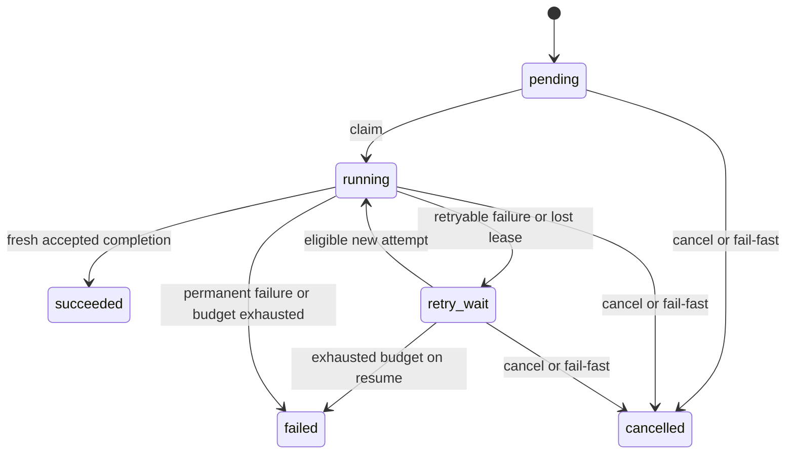

# deep3d 系统数学模型 v0.2

日期：2026-10-27。依据：Rust 工程内核与 `f729193` 的持久并发运行时。本文是新的系统建模基线；涉及扩展的定义不表示相应功能已经实现，也不构成形式化验证证书。

上位目标和最终验收口径以 [目标状态契约 v1.0](target-contract-v1.md) 为准；端口与系统落地见 [系统设计 v1.0](system-design-v1.md)。PostgreSQL、OCCT 和当前类型只是实现适配，不构成不可替换的产品定义。

系统定义为**受工程合同约束、以不可变版本和产物为工作对象、通过带执行权的事务推进的持久计算系统**。CAD、任务调度、验收和交互分别有自己的状态与判定规则。规划者可以由人、规则或模型实现，不持有改变这些规则的权力。

## 1. 总体分解

令系统状态为：

$$
X=(\mathcal G,\mathcal S,\mathcal B,\mathcal O,\mathcal R,\mathcal A,\mathcal K,\mathcal E)
$$

| 记号 | 含义 | 当前对应 |
| --- | --- | --- |
| $\mathcal G$ | 不可变目标合同、条件与验收政策 | 当前为冻结 Task 参数合同的受限表达；尚无独立 GoalRevision |
| $\mathcal S$ | 不可变工程规范及父版本关系 | `Project`、`Revision`、事务 |
| $\mathcal B$ | 当前选中的工程/分支头及代数 | 本地包 `HeadToken`；云端 Branch ID/Publication head 尚待实现 |
| $\mathcal O$ | 内容寻址的实际字节对象与绑定清单 | `.deep3d`、materialization、CAS |
| $\mathcal R$ | 固定任务定义及 Run/Task 状态投影 | `RunSpec`、`TaskSpec`、数据库状态 |
| $\mathcal A$ | Attempt、固定输入、租约、截止和结果回执 | `attempts`、completion receipt |
| $\mathcal K$ | 控制状态与执行代数 | `control_epoch`、`execution_epoch` |
| $\mathcal E$ | 有序业务变化通知 | 每 Run 事件序号及事件内容 |

状态仅能通过带守卫的转换改变：

$$
X\xrightarrow{a}X'\quad\Longleftrightarrow\quad
\operatorname{Guard}_a(X)\land X'=\operatorname{Effect}_a(X)
$$

守卫由受信任服务和数据库执行；模型输出只能构成动作提案。状态投影可以改变，冻结的定义、已接受输出和幂等回执不能改变含义。事件日志目前不包含全部续租事实，不能把当前数据库实现描述成可由事件单独重建的 Event Sourcing 系统。

### 1.1 独立的目标合同

目标定义为：

$$
g=(id,version,scope,RequiredCriteria,HardConstraints,
Deliverables,precisionPolicy,acceptancePolicy)
$$

一个条件包含稳定 criterion ID、适用域、观测方法、目标、阈值、验收阶段和证据来源要求。目标定义“什么算完成”，Task 定义“安排哪些工作”，两者不能互相替代。目标变更创建新版本，不能就地放宽旧条件。

有效目标要求必需验收集合非空，至少包含交付物与其验证条件。`Required(g)` 包含全部必需条件、硬约束及必需交付检查；只安排空工作不构成工程目标达成。

当前实现只覆盖受限目标：由冻结源工程、Task 参数修改、精度配置和必需 BREP/STEP 产物共同确定。数学模型把它视为完整目标体系的子模型，未假定数据库已经存在独立 GoalRevision 或制造/装配验收政策。后续 Run 应显式绑定目标版本；当前通过新的 Run 表达新的冻结委托。

## 2. 工程规范：带类型的数据流

一个工程规范为：

$$
S=(N,G_F,\theta,\rho,\nu,\zeta)
$$

$N$ 是带稳定身份的 Scene 树；$G_F=(F,E_F)$ 是 Feature DAG；$\theta$ 是参数环境；$\rho$ 是端口、参数和节点输出绑定；$\nu$ 是精度策略；$\zeta$ 是 schema、操作和单位/坐标版本。

参数属于类型化量空间：

$$
\theta\in\prod_i\mathcal Q_{d_i},\qquad
d_i\in\{\mathrm{Length},\mathrm{Angle},\mathrm{Unitless}\}
$$

内部采用 mm、rad、右手 Z-up。角度在量纲分析中可视作无量纲，但工程类型仍与一般比例值区分，避免单位兼容性被数值类型掩盖。

每个特征具有版本化签名：

$$
f_i:(\operatorname{InputTypes}_i,\operatorname{ParameterDomain}_i)
\longrightarrow\operatorname{Result}(\operatorname{OutputType}_i,\operatorname{Error}_i)
$$

规范有效条件至少包括身份唯一、树/DAG 无环、端口类型一致、引用存在、有限数、参数域及精度策略有效。当前支持 circle/extrude/cut；一般草图、圆角、装配只是在这个类型体系中的后续操作。

事务 $q$ 是顺序命令复合，作用于私有规范副本：

$$
\tau_q(S)=
\begin{cases}
S' & \operatorname{Apply}(q,S)=S'\land\operatorname{ValidSpec}(S')\\
\operatorname{Error} & \text{其他情况}
\end{cases}
$$

命令中途失败不产生部分正式修改。规范版本记录 $(id,parent,H(S),H(q))$；这里的版本身份与几何执行成功相互独立。当前原生包中每条历史是单父链，并发候选可以拥有同一父版本。

## 3. 几何求值：来源固定，字节结果独立登记

固定工程规范不能推出跨进程、跨平台的输出字节必然相同。STEP 头、序列化和浮点计算细节可能不同。因此使用求值关系：

$$
(S,e)\leadsto M\quad\text{或}\quad(S,e)\leadsto\operatorname{Failure}(c)
$$

$e$ 包含内核/绑定版本、Worker 与验证器代码、数值选项和交换配置；$M$ 包含实际 B-Rep、逐 Feature 产物、STEP、诊断和清单。每次实际结果分别按字节摘要登记：

$$
\operatorname{ObjectID}(b)=H(b)
$$

摘要证明的是给定字节的完整性和引用绑定，依赖抗碰撞假设；它不证明几何正确，也不赋予 Worker 权限。规范元数据使用规范编码，实际文件摘要使用实际文件字节。

B-Rep 可抽象为具有几何嵌入、方向及容差标注的拓扑结构：

$$
B=(V,E,W,F,Shell,Solid,\Gamma,Orientation,Tolerance)
$$

这描述内核处理的对象类别，不替代 OCCT 的有效性算法。Scene/Feature 的稳定 UUID 也不能推出 Face/Edge 在重算或 STEP 重新导入后具有稳定编号。

未来子拓扑引用应建模为版本绑定的查询：

$$
\operatorname{Resolve}(q,M)\in
\{\operatorname{Resolved}(x),\operatorname{Missing},
\operatorname{Ambiguous},\operatorname{Unsupported}\}
$$

只有候选集合满足预期基数和语义条件时才解析成功。例如要求唯一平面时，零个或多个匹配都必须显式处理。跨版本拓扑命名、语义选择器和完整操作历史目前没有据此宣称实现。

### 3.1 增量计算与缓存身份

三类身份分别定义：操作缓存键描述“计算什么”，Attempt ID 描述“这一次执行”，对象摘要描述“实际得到了哪些字节”。未来几何缓存键可为：

$$
K_{geom}=H(opVersion,inputGeometryHashes,typedParameters,
frame,precision,engineBuild)
$$

它不承担规范版本、目标、证据或执行权限的身份。复用几何仍需建立当前版本/目标的绑定并确认验收适用性；不能因缓存命中继承旧执行权。

对参数或特征定义变化 $\Delta$，几何失效集合为保守闭包：

$$
D_0=ChangedFeatures\cup Readers(ChangedParameters),\qquad
D=Descendants^*_{E_F}(D_0)
$$

几何政策或内核变化时扩大到全部相关特征。Scene 重命名可以不重算几何，但规范和交付元数据仍有新身份；输出绑定改变也要重建相应清单。当前已有失效闭包计算，Worker 仍全量求值，尚无上述操作缓存。

## 4. 验收：有范围的谓词与证据绑定

每个目标条件 $c_i$ 定义独立输入、观测方法、允许范围及适用域。验证结果为：

$$
v_i(M,g,\nu,e_v)\in\{\mathrm{Pass},\mathrm{Fail},\mathrm{Inconclusive}\}
$$

缺少证据、几何类型超出验证器能力或无法可靠测量时，不能计作 Pass。接纳条件为所有必需条件明确通过，且结构、来源及版本绑定完整：

$$
\operatorname{Acceptable}(M,g)=
\operatorname{ValidGoal}(g)\land\operatorname{BindingValid}(M,g)\land
\bigwedge_{i\in Required(g)}[v_i=\mathrm{Pass}]
$$

一份证据的逻辑绑定至少为：

$$
E_i=(inputHash,specID,manifestHash,goalHash,criterionID,
validatorBuild,precisionHash,outcome,reportHash)
$$

当前实现以冻结任务参数、精确规范比较、物化清单及原生/STEP 报告形成这一绑定的子集；完整 GoalRevision、独立 Evidence/Assessment 实体和验证服务身份认证仍需补齐。

当前解析法兰的尺寸软件验收规则为：

$$
|m_i(M)-\theta_i^*|+g_i\le\epsilon_i^{effective}
$$

$g_i$ 是开发验收 guard band，尚不能解释为经过校准的测量不确定度。当前 STEP 尺寸规则采用关键尺寸阈值与 STEP 阈值的较小值。

新模型要求将两个问题分别表达为条件：交付几何相对设计目标的误差，以及交换前后观测之间的误差。未来显式的交换差分条件为：

$$
|m_i(M_{STEP})-m_i(M_{BREP})|+g_i^{exchange}
\le\epsilon_i^{exchange}
$$

现有实现分别对目标检查 BREP/STEP，尚未提供独立的跨文件差分 Evidence。软件 guard、内核 working tolerance、子形状自身容差、设计公差和制造能力必须分别管理。

距离小于公差的关系通常不具传递性，不能把近似相同的几何自动归入一个可任意替换的等价类。缓存复用需要重新确认合同和来源适用性。

协调服务当前会重新打开原生包、验证哈希和报告绑定，不会再次运行 OCCT。以上软件验收依赖受信任的 Worker、独立验证进程及存储边界，不是对任意零件正确性的数学证明。

## 5. 任务图：先后关系与数据来源分开

一个固定计划为：

$$
\Pi=(T,E_{order},E_{data},\{q_t,b_t,\Delta_t\}_{t\in T})
$$

$E_{order}$ 定义先后条件；$E_{data}$ 定义实际数据输入；$q_t$ 为类型化工作定义；$b_t$ 是总尝试次数上限；$\Delta_t$ 是单次 Attempt 的持续时长上限。

当前 `depends_on` 对应 $E_{order}$，`source_task` 对应至多一个几何输入边，并要求它属于先后依赖。一次 Task 内部可以计算整个 Feature DAG，两张 DAG 不能合并理解。

当前输入解析为：

$$
I_t=
\begin{cases}
I_{Run} & source\_task(t)=\bot\\
Output(u).source & source\_task(t)=u\land state(u)=succeeded
\end{cases}
$$

输入以 $(artifactHash,revisionID,generation)$ 冻结在 Attempt 中。恢复创建新 Attempt，可以根据既定计划重新解析合法来源，不能改写旧 Attempt 的输入。

可领取集合为：

$$
Ready(X)=\{t\mid state(Run)=running\land
state(t)\in\{pending,retry\_wait\}\land
available_t\le now_{DB}\land attempts_t<b_t\land
\forall u\prec_{order}t:state(u)=succeeded\}
$$

一个任务同时依赖多个上游，表示等待这些任务，不自动表示融合它们的 B-Rep。未来装配/多输入操作需要显式的端口到 Artifact 映射，不能从 `depends_on` 猜测数据流。

## 6. Run、Task、Attempt 与时间

一个 Run 的持久状态抽象为：

$$
R=(id,g,\Pi,I_{Run},state,c,\{T_t\},\{A_{t,k}\},Receipts,eventSeq)
$$

$c$ 为控制代数。每个 Task 投影至少包含状态、当前 Attempt、执行代数、下一次可运行时间、输出和错误。每个 Attempt 固定输入、Worker、执行/控制代数、绝对截止、租约截止、结果或失败回执。

上图是 Task 投影。Run 的立即暂停会撤销活动 Attempt，把未完成工作停留在待重试状态；Run 恢复才重新允许领取。Attempt 自身的 `abandoned` 记录与 Task 的 `retry_wait` 不能混用。

令一次执行凭据及其服务端租约记录分别为：

$$
\lambda=(runID,taskID,attemptID,workerID,e,c),\qquad
L_\lambda=(\ell,d)
$$

$e$ 为执行代数，$\ell$ 为租约截止，$d$ 为本次 Attempt 的硬截止。两个截止时间从数据库当前记录取得，不接受调用者自行声明。执行资格判定为：

$$
\operatorname{Authorized}(\lambda,X,\tau)=
\operatorname{CurrentTuple}(\lambda,X)\land
state(Run)=running\land state(Task)=running\land
\tau<\min(\ell,d)
$$

`CurrentTuple` 同时检查 Run/Task/Attempt/Owner、当前 Attempt 指针、执行代数和控制代数。仅检查时间或 Worker ID 均不充分。

领取时 $d=time_{claim,DB}+\Delta_t$，续租不延长这个硬截止。当前 Worker 角色采用共享服务凭据；Worker ID 是并发归属字段，尚非独立的节点身份认证。执行隔离依赖受信任节点，后续多租户需要额外的身份与范围授权。

授权时间 $\tau$ 来自取得 Run/Task/Attempt 锁之后的数据库时钟。续租规则是：

$$
\ell'=\min(d,now_{DB}+L),\qquad
\operatorname{Authorized}(\lambda,X,now_{DB})
$$

过期租约不能被续租复活。Worker 本地时钟只用于尽力停止计算，不决定数据库写入资格；时钟偏差可能造成浪费或提前退出，不能用于绕过服务端判定。

**授权判定点与物理提交时刻不同。** 事务可以在租约截止前锁后获准，随后在截止后提交；Run 锁保持到提交，竞争的恢复/控制不能插入其中。本模型保证判定点合法且事务串行可解释，不要求未经实现的 $time_{commit}<\ell$。这一时间选择对应 PostgreSQL 的 `clock_timestamp()` 与行锁语义。[时间函数](https://www.postgresql.org/docs/16/functions-datetime.html)、[行锁](https://www.postgresql.org/docs/16/explicit-locking.html)

该判定仅在当前持锁事务内有效。事务回滚或新事务重试时重新校验；已经成功的幂等回执读取是后文规定的例外。

## 7. 并发：计算并行，接纳决定串行

两个 Attempt 可以物理并行计算，不代表它们都能修改同一权威状态。核心不变量是：

$$
\forall t:\quad |AuthoritativeRunningAttempt(t)|\le1
$$

$$
\forall t:\quad |AcceptedOutput(t)|\le1
$$

第一条不限制失权进程是否还活着；第二条不限制重新计算次数。Run 行锁和状态守卫约束数据库执行权，进程隔离与资源管理约束实际计算，两者分别实现。

不可变版本集合不能确定当前选中哪个版本，因此显式保存头映射 $\mathcal B[b]=(kind,head,generation)$。这里 $b$ 表示所操作的工程包/分支作用域。正式工程头需要另一个规则：

$$
\operatorname{CAS}((head,generation),(head_{expected},g_{expected}),head_{new})
$$

只有两项前置条件同时相等时，才移动 head 并递增 generation。同一 Base 上的并发候选可以全部计算完成，但不能凭先前的 Base 自动覆盖新 head。

当前持久运行时接纳的是私有产物，不调用 `adopt` 移动原工程 Head。正式数据库 Publication 与原生文件替换不能假装共享一个原子事务；后续正式发布必须在业务数据库中定义自己的分支与发布记录。

## 8. 完成接纳的幂等：新接纳与历史回执是两个动作

先通过角色及身份归属检查。令完成操作身份为 $k=(complete,run,task,attempt)$，规范化请求摘要为 $h$。摘要包括执行凭据与选定物化；其他操作也必须使用带操作类型和作用域的键。完成回执表逻辑为：

$$
Receipt(k)=
\begin{cases}
(h,result) & \text{已提交}\\
\bot & \text{尚无提交事实}
\end{cases}
$$

处理规则：

1. 已有同身份、同摘要回执：返回原结果，不授予新的执行权。
2. 已有同身份、异摘要回执：拒绝。
3. 尚无回执：执行新的授权、验收及事务接纳。

因此 `ReplayReceipt` 可以在租约过期、Run 完成甚至控制状态改变后返回，`FreshCommit` 必须通过当前执行资格。不能把“所有请求都要租约有效”错误地施加到历史回执读取上。

以上例外针对输出完成接纳，各操作的实际语义分别为：

| 操作身份 | 相同请求重发 |
| --- | --- |
| Submit：Run UUID | 返回同一冻结委托；输入路径后来变化不改原委托 |
| Claim：Worker ID + Claim UUID | 原领取仍有效才返回租约，已过期则拒绝；空领取仍返回空 |
| Heartbeat：当前执行凭据 | 每次重新检查并续租，不是读取不可变回执 |
| Failure：Run/Task/Attempt | 已登记的同摘要失败只返回确认，不再修改替换后的 Attempt |
| Control：Run UUID + Operation UUID | 返回原动作的历史回执；当前状态另读状态快照 |

不能将完成回执的过期后重放规则直接应用到领取或续租。

计算执行次数可能大于一；数据库接受同一 Task 输出的次数至多为一。是否最终获得一次成功接纳还依赖可用性和重试条件，不能仅凭幂等宣称外部计算恰好一次。

## 9. 对象与数据库：先登记可用字节，再接受引用

一次新结果的接纳顺序为：

$$
Compute\prec Verify\prec DurableObject\prec FreshCommit
$$

计算和文件检查在数据库事务外。`FreshCommit` 在短事务内重新检查执行资格，再登记输出、回执、Task 状态和业务事件。

由此允许：对象已持久化，但事务失败，留下无引用对象。禁止：仅收到 Worker 的 Pass 字段就接纳一个尚未验证、不可读取或与输入不匹配的对象。

当前存储可信、对象不被覆盖/删除且数据库满足其部署耐久性合同，是安全前提。摘要无法阻止物理磁盘丢失；后续对象不可变权限、Pin/GC、备份恢复及复制必须保持这一前提。不能从本地 `fsync` 推出跨主机或跨区域 RPO=0。

## 10. 长程：持久状态与有条件的推进

业务任务的寿命不等于任何 Worker、HTTP 请求、模型上下文或进程的寿命。进程可以消失，Run/Task/Attempt、重试时间和回执继续存在于数据库。

当前固定 DAG 的推进性质为：如果数据库与兼容 Worker 最终可用，数据库时间最终前进，恢复与可运行任务得到公平处理，动作在截止内成功或明确失败，且没有持续暂停，那么有限 DAG 最终到达终态。

$$
\text{上述假设}\Longrightarrow
\Diamond(state(Run)\in\{completed,failed,cancelled\})
$$

这是有条件的活性陈述，终态可以是失败。它不是有限 RTO 证明，也不保证永久不可达的几何目标最终成功。暂停可以无限等待；每个开始过的 Attempt 都消耗预算，暂停不会退回尝试次数。

未来开放式委托可由多个冻结计划阶段构成：

$$
Run=(\Pi_0,\Pi_1,\ldots),\qquad
Activate(\Pi_{j+1})\Rightarrow c'=c+1
$$

每个阶段有限、有界、有独立输入和授权。保留 Task 定义或已有产物，不意味着旧 Attempt 获得新计划的权限。当前代码只实现一个冻结计划；继续其他工作可以建立新 Run，尚无原地动态计划激活。

## 11. 调度与资源：先定义可行动作，再选择效率策略

调度器从合法动作集合中选择：

$$
\mathcal U(X)=\{a\mid\operatorname{Guard}_a(X)\land
\operatorname{PolicyAllowed}(a,X)\land\operatorname{CapacityAllowed}(a,X)\}
$$

工程约束和权限是硬条件，不能通过成本或奖励权重抵消。满足硬条件之后，再讨论公平性、截止、吞吐、资源成本及不必要的重复计算。

当前容量包括每 Worker 的固定槽数和每 Run 最多 8 个有效执行槽，按 Run 最近调度时间轮转。它们不是跨集群 CPU/内存/费用的全局保证，也不能把仍在退出的失权进程算成物理上已经释放资源。

当前选择策略优先首次调度的 Run；持续新 Run 到达或所有 Worker 都定向过滤其他 Run 时，不提供无条件的无饥饿证明。活性条件中的公平处理是一项显式假设，后续须通过准入、老化或公平队列实现。

未来即时计算资源向量为 $r_t=(cpu,memory,gpu)$，资源预留满足：

$$
\sum_{t\in Reserved}r_t^{(j)}\le Capacity^{(j)}
$$

存储与费用有不同时间语义，分别表达：

$$
StorageUsed+StorageReserved\le StorageLimit
$$

$$
AdmitBillableStep\Rightarrow
Spent+MoneyReserved+NewReservation\le MoneyLimit
$$

已完成且保留的对象仍占存储；已发生费用不能因计算槽释放而消失。未知账单保留待结预留，失败、取消和重复计算仍记录真实消耗。若实际账单超出预留，应记录超支并阻止新计费动作，不能丢弃真实账单来维持不等式。当前没有这组资源/费用账本。

## 12. 进度、规划与交互

规划者只产生提案：

$$
\pi(Context,History)\rightarrow Proposal
$$

提案通过类型、依赖、权限、资源和验收规则后，才能成为冻结定义或合法动作。更换规划者不改变数据库接受结果的条件。

未来业务目标的进度应由当前目标、当前交付上下文下仍适用的验收条件计算，例如：

$$
Progress_g=\frac{\sum_i w_i\mathbf1[Assessment(c_i,g)=Pass]}{\sum_i w_i},\quad w_i>0
$$

该定义要求有效目标的必需条件非空，且 $\sum_iw_i>0$。权重只用于展示，不允许重要条件被其他分数补偿。目标或输入改变时，旧 Evidence 可能不再适用，进度可以下降。消息数、在线时间和工具次数不能充当工程完成度。

当前 `Run.completed` 的准确含义为固定任务图全部成功、每个输出已经验证登记。它不等价于未来完整业务合同的 `GoalFulfilled`；装配、制造、审批和客户交换条件尚需独立表达。

通知是业务变化的选择性投影：交付可用、明确阻塞、需要决定。续租和普通重试留在内部记录。当前只提供事件查询，没有外部通知投递器。

## 13. 以法兰贯穿模型

设外径 $D$、厚度 $h$、中心孔径 $d_0$、螺栓孔径 $d$、节圆直径 $P$、孔数 $n$。长度统一 mm，$D,h,d,P>0$，$d_0\ge0$，$n\in\mathbb N,n\ge3$。孔中心为：

$$
p_i=\frac P2(\cos(\varphi+2\pi i/n),\sin(\varphi+2\pi i/n))
$$

等间距通孔、互不重叠且完全位于圆盘内时：

$$
V=\frac{\pi h}{4}(D^2-d_0^2-nd^2)
$$

若最小材料壁厚为 $w>0$，一组必要的解析间距条件为：

$$
\frac{D-P-d}{2}\ge w,\qquad
\frac{P-d-d_0}{2}\ge w,\qquad
P\sin(\pi/n)-d\ge w
$$

同时还需要正尺寸、支持范围和真实 B-Rep/交换验收。这些解析公式不能替代实际输出检查。

当前样例 $D=100,h=12,d_0=30,d=8,P=70,n=4$。计划并行计算 $h\mapsto16$ 与 $P\mapsto80$ 两个变体，再基于厚度变体修改 $P$。最终 $h=16,P=80$，原工程仍固定在初始版本。

在上述合法条件下，改变 $P$ 不改变体积；因此验收同时检查孔中心和孔距。Feature DAG 表达圆/拉伸/切除，Task DAG 表达变体与接续，Artifact 摘要绑定实际文件，Attempt 凭据决定谁可以登记结果。每个对象在同一例子中承担不同的数学角色。

## 14. 不变量与代码对应

| 不变量/义务 | 当前落点 | 边界 |
| --- | --- | --- |
| 规范和依赖有效，事务不部分修改 | `core-domain` | 三种 Feature 操作 |
| 同工程修改检查版本与 generation | `core-storage` | 本地原生包单分支 |
| Run 与 Task 定义冻结，重复提交不改含义 | `core-runtime::submit` | 固定 DAG |
| 每 Task 最多一个当前执行凭据 | `claim/heartbeat/recover` | 不保证只有一个物理进程 |
| 撤权之后旧凭据不能新登记输出 | `require_active/control` | 回执重放例外 |
| 结果绑定固定来源、精确规范与物化 | `runtime-service::artifacts` | 可信进程/存储边界 |
| 对象先可用，业务引用后提交 | `verify_result/complete` | 未引用对象暂不自动删除 |
| 同 Task 已接纳结果不被重试替换 | `completion/complete` | 不等于计算恰好一次 |
| 状态快照和游标一致 | `get_run` 的数据库快照 | 事件不是全部状态事实 |
| 满足可用性/公平性假设后可终止 | 截止、重试预算、恢复扫描 | 未建立硬 RTO/可用性证明 |

这些是设计约束与代码检查点，不把工程回归等同于形式化证明。

下一轮实现按三个明确差距推进：

1. 为业务目标、验收条件和计划阶段建立独立版本，使固定任务完成与完整目标满足可以分别判断。
2. 建立数据库正式分支/Publication 与证据适用性，接入生成结果到受保护工程版本的接受流程。
3. 将资源预留、费用、外部等待及通知投递纳入持久状态；再引入可替换规划者和 Temporal 编排。

本模型不引入未经需要的全局 CRDT、自动 B-Rep 合并或统一奖励函数。分布式执行只要求必要的因果先后关系，单个 Run 的业务决定用数据库串行化；不要求把所有计算事件强行放入一个全局物理时间序列。事件偏序的概念来源见 [Lamport, Time, Clocks, and the Ordering of Events in a Distributed System](https://lamport.azurewebsites.net/pubs/time-clocks.pdf)。
