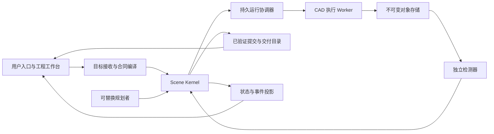

# Agent-Native 3D Modeling System：系统设计 v1.0

基准日期：2026-10-27。V0.1 目标验收日期：2026-11-01。

本文定义实现目标、系统边界与验证方法，不声明目标已经完成。上位要求是 [目标状态契约 v1.0](target-contract-v1.md)；数学关系沿用 [系统数学模型](mathematical-model.md)，但实现优先级与验收口径以本次目标契约为准。当前实现和观测结果必须另行报告，不能由设计文档推定。

系统的交付单位是一个**经过验证、可编辑、可重建、可下载的工程版本及其证据包**。自然语言对话、计划、单个 CAD 调用和后台进程都是产生交付物的手段。

## 1. 产品闭环与本周边界

用户从一个简洁入口提交目标或变更，系统依次完成：

1. 保留原话与来源，形成版本化目标提案；把缺失、冲突和无法检测的要求列出。
2. 接受可检查的目标合同，确定必需条件、交付物、单位、容差与权限。
3. 提出有界的建模计划和类型化 IR，验证能力、引用、资源和依赖后冻结计划阶段。
4. 在固定源版本上执行候选；并行计算相互独立的工作。
5. 对实际几何、结构、约束和交付文件运行检测器。
6. 协调器在仍有效的目标、计划与工程 Base 下接受已验证提交。
7. 用户查看模型、参数、特征、组件、差异、证据和阻塞，下载源工程与导出物。
8. 目标变化或故障进入同一条版本、失效、恢复流程，最后正确版本继续可用。

本周面向参数化实体、结构化场景与小型刚性装配。自由曲面、雕刻、贴图、动画和有限元不计入本周成功承诺。材料牌号、密度或来源可作为有出处的数据保存；强度、寿命、可制造性等没有适用检测器的物理结论保持“不可验证”，不能从材料名称或模型外观推断。

工程工作台按需展开。默认入口呈现目标、最新已验证结果、实际阻塞和需要的决定；参数表、Feature 树、三维查看与版本接管始终可访问。当前方案不绑定某个消息、语音或模型服务。

## 2. 一套权威状态，多个可替换端口



Scene Kernel 是逻辑权威：它维护工程规范、稳定身份、命令语义、版本与接受规则。数据库和文件格式是权威状态的存储实现，不能各自维护互相冲突的“最新工程”。

| 端口/模块 | 输入与输出 | 权限边界 |
| --- | --- | --- |
| Goal Intake | 原话、附件、来源 → GoalProposal | 可产生提案，不可自行判定完成 |
| Contract Compiler | 提案、能力目录、用户决定 → GoalRevision | 验证条件可检查、单位明确、来源可追踪 |
| Planner Port | 当前目标、工程、能力与失败事实 → PlanProposal | 可替换为模型、规则或人工规划，不直接写工程/验收结论 |
| Scene Kernel / Modeling IR | 固定版本 + 类型化命令 → 候选规范、读写集、差异 | 静态校验、命令原子性、稳定身份由这里定义 |
| Runtime Port | 冻结计划与授权 → Attempt、等待、重试与恢复 | 调度不能修改目标或绕过验收 |
| Geometry Engine Port | 冻结 Feature 与输入产物 → B-Rep、诊断、来源 | 不持有公开 Head 的推进权 |
| Verifier Port | 候选、独立合同、实际文件 → Evidence | 测量实际几何；不接受模型或 Builder 自报值代替测量 |
| Authority Store Port | 版本、条件写入、回执与事件 | 提供事务、作用域隔离、CAS 和执行代数语义 |
| Artifact Store Port | 字节与摘要 → 不可变可读取引用 | 缺块、摘要不符或不可读时禁止接纳 |
| Delivery / Observation | 已验证版本与证据 → 查看、差异、复现包、状态 | 公开结果只取已验证提交，候选必须清楚标识 |

当前 Rust、PostgreSQL、Python/OCP、`.deep3d` 可以继续使用。替换实现必须通过端口合同，不能靠名称相同推定语义兼容。更换内核、求解器或精度政策产生新的执行身份与物化结果；更换规划模型不更改已冻结的目标、计划和工程事实。

本地单写入者配置可以用原生包提供原子版本提交；云端配置用数据库提供跨 Worker 的权威事务。两种配置要显式声明能力，不能把“数据库记录 + 独立文件替换”伪装成一个跨存储原子提交。

## 3. 工程源模型

### 3.1 三种结构各有责任

| 结构 | 保存内容 | 改变时的主要影响 |
| --- | --- | --- |
| Scene Graph | 组件组织、Part 定义、Instance、放置、角色和结构关系 | 场景组织、实例位置、装配检测与交付元数据 |
| Feature DAG | 参数、草图、操作、端口、datum 与几何依赖 | 求解、几何失效和重算 |
| Goal/Plan 图 | 用户要求、验收条件、工作阶段、任务依赖与证据覆盖 | 工作安排及当前完成状态 |

组件身份与放置分开：一个 PartDefinition 可被多个 Instance 引用；移动一个 Instance 不重新定义共享零件。装配关系需要显式记录被引用的 datum、尺寸或变换。当前通过 Feature 变换链表达的实例可以作为兼容输入，后续应归一化为这套领域对象。

任务依赖表达先后条件，数据端口表达读取哪个产物。等待两个上游成功不意味着自动融合两个实体；布尔、装配和多输入几何必须通过显式操作与端口表达。

### 3.2 稳定 Modeling IR

人和 Agent 使用同一组命令。IR 不包含任意 Python、Shell、SQL 或隐式“当前选中物体”。每个命令有版本、类型、适用域、读写语义和失败码。

目标命令族：

- 参数/表达式：创建、赋值、关系替换，长度、角度和比例保持类型。
- Feature：创建、替换、删除和显式端口重接线。
- Scene：组织调整、Part/Instance 创建与放置、稳定引用。
- Contract：独立的目标提案与目标版本确认接口。

普通建模命令不能放宽验收合同。当前机械工程事务中的 `acceptance.set` 是操作员提供独立验收目标的兼容入口；Agent 工具权限应将它与普通参数编辑分离。正式目标变化必须创建 GoalRevision 并推进控制代数。

一个建模事务至少绑定：`project_id`、`base_spec_revision`、`expected_generation`、`transaction_id`、`goal_revision_id`、`control_epoch`、命令列表。固定命令按顺序在私有规范上应用，最后同时验证引用、类型、参数域、Scene、Feature DAG 与目标绑定。失败不部分改变已验证工程。

能力目录返回可调用的操作版本、输入/输出类型、参数域和已支持检测器。规划者遇到能力缺口时产生结构化阻塞，不能换一个未注册操作名或偷偷降级为不可编辑网格。

## 4. 目标、计划和验收的实体合同

下列为目标 schema，尚未据此声称数据库表或 API 已实现：

| 实体 | 必需的冻结字段 |
| --- | --- |
| GoalRevision | `goal_id, revision, parent, original_request, source_refs, scope, criteria, deliverables, precision_policy, status` |
| Criterion | `criterion_id, subject_refs, applicability, observation_method, expected, tolerance, stage, required, source_refs` |
| PlanRevision | `plan_id, goal_revision_id, base_spec, tasks, dependencies, resource_limits, stop_conditions` |
| TaskDefinition | `task_id, operation_kind, source_ports, IR/change intent, acceptance_refs, max_attempts, deadline_policy` |
| Attempt | `attempt_id, task_id, input_snapshot, goal/plan_ids, worker, execution_epoch, control_epoch, lease_until, hard_deadline` |
| Candidate | `candidate_id, spec_revision, materialization, base_verified_head, read/write sets, environment, attempt` |
| Evidence | `criterion_id, exact inputs, goal/spec/materialization, validator build, policy, outcome, report artifacts` |
| Assessment | `goal_revision, candidate/commit, criterion, evidence_refs, applicability, outcome` |
| VerifiedCommit | `commit_id, project/branch, parent, goal/spec/materialization, evidence_set, operation identity, authorization facts` |
| DeliveryManifest | `commit_id, source package, exports, scene/BOM, parameter/feature views, diff, evidence index, reproduction recipe` |

身份包含项目/Run 等作用域，不能只靠“UUID 很随机”代替归属检查。所有数值带单位；64 位代数在跨语言 JSON 中采用不会损失精度的表达。规范、目标、计划、产物和正式接受事实不原地改写。

目标的要求分别标记“可执行可检查”“待确认”“不可验证”“冲突”。已接受的可执行目标必须有非空必需验收集合。原始要求没有被悄悄删掉；未解决项会出现在进度和阻塞中，并阻止对整个目标声称完成。

目标状态与运行状态分开。一个 Run 可以因预算、依赖或错误停止；它不因此满足目标。旧目标曾经满足的历史事实保留，新目标的当前完成状态重新计算。

### 4.1 对外接口与内部端口

下列是需要落成的协议动作；路径是拟议 API，不是当前路由清单：

| 动作 | 关键请求条件 | 稳定响应 |
| --- | --- | --- |
| `SubmitIntent` | 项目、请求 UUID、原话/附件来源、预期目标版本 | GoalProposal、结构化条件、待确认/冲突/不可验证项 |
| `AcceptGoal` | 提案 ID 与摘要、预期 GoalRevision、操作者范围 | 不可变 GoalRevision、控制代数、事件游标 |
| `ProposePlan / ActivatePlan` | 固定目标、Base、计划摘要及预期控制代数 | 冻结 PlanRevision 或逐项拒绝原因 |
| `ApplyIR / CreateCandidate` | Base token、IR 操作身份、目标/计划和执行上下文 | 候选规范、读写集、预期失效和差异 |
| `Claim / Renew / RecordFailure` | 作用域、请求身份或当前执行凭据 | 固定输入、租约/截止或结构化失权/重试结果 |
| `SubmitEvidence` | 候选与实际文件、Criterion、验证器身份和输入摘要 | 不可变 Evidence；不直接推进公开 Head |
| `AcceptVerifiedCommit` | Candidate、Evidence、目标/计划、Base/CAS、操作 UUID | 固定提交及公开 Head，或明确冲突 |
| `GetStatus / GetDiff / GetEvidence` | 指定目标版本与提交，可选游标 | 一致快照、来源与证据定位 |
| `CreateDelivery / DownloadDelivery` | 指定 VerifiedCommit、格式 profile | 内容寻址交付清单和可校验下载 |

适配层可以把动作映射到 HTTP、CLI 或消息入口，业务校验只有一份。已经成功的命令回执是历史操作结果，查询当前状态必须读取带版本和游标的状态快照。

## 5. 真实几何、验收与设计意图

验收链固定为：源规范与独立目标 → 实际几何生成 → 新进程重新加载 BREP/STEP → 可重复检测 → 证据绑定 → 当前适用性裁定。

检测器按条件类型注册：

| 条件 | 检测依据 |
| --- | --- |
| 实体有效性 | 实际 B-Rep 分析、闭合、方向、纯实体结构、容差与空几何检查 |
| 尺寸与形状特征 | 实际解析曲面、边界、孔轴/孔径、厚度等适用测量 |
| 体积/质量 | 对实际实体积分；质量另需有来源的密度 |
| 位置与装配 | 实例实际放置、相对坐标、间隙/连接条件与相交体积 |
| 结构与可编辑性 | 原生 Scene/Feature/参数完整性、引用闭包、无 Agent 重建与编辑重建 |
| STEP 交付 | 新进程重导入后的单位、实例、名称、结构与规定几何条件 |

体积、包围盒与 B-Rep 有效性不能单独证明孔位、圆角半径或连接要求正确。每个预注册任务必须列明适用的独立条件；缺少适用检测器时，该条件为“证据不足”，不得靠已有通用检查数量补偿。

证据结果采用 `pass / fail / inconclusive`；面向用户映射为“通过／未通过／证据不足”。已知违反条件为 fail；超出检测器适用域或缺少依据为 inconclusive。全部必需条件通过、绑定有效且交付闭包完整，才允许完成裁定。

所有证据绑定实际文件摘要、规范、目标、精度政策、验证器及观测方法。当前进程分离提供开发边界；更强的多租户环境还需要独立服务身份和受控存储权限。代码哈希与报告绑定不等于任意受攻击 Worker 的可信证明。

源资产必须包含建模意图和重建所需输入。缓存 BREP、STEP 和预览均是源资产的派生产物。外部几何若不能恢复原始参数化历史，应明确记录“导入实体”及其可编辑边界，不能伪装成原生参数化设计。

## 6. 精确失效与实际增量执行

S4 同时要求正确依赖判断和实际复用。只计算 dirty 集后仍重建全部 Feature，不满足目标。

### 6.1 六类变化分别追踪

`DefinitionDirty`、`SolveDirty`、`GeometryDirty`、`PlacementDirty`、`DeliveryDirty`、`EvidenceStale` 分别表达源定义、草图约束求解、零件局部几何、实例放置、交付元数据及验收适用性。

重命名可以改变源规范、名称和 STEP/BOM，不必调用实体算法。移动实例会改变放置与装配检查，但不必重算共享零件定义。目标阈值改变可能只需新裁定或重验，不自动使几何失效。

### 6.2 属性级语义读写集

每个动作的读取记录为：

```text
ReadRef = {
  entity_id, property_path, projection_hash,
  dependency_kind, source_revision
}
WriteRef = {
  entity_id, property_path, before_hash, after_hash,
  change_kind
}
```

几何动作读取归一化操作定义、参与求值的参数、输入几何、相关坐标与精度。跨组件引用读取具体 datum、尺寸或变换。不能把整个 Project revision 当作所有动作的几何输入，否则改名称也会产生全场景失效。

`source_revision` 用于来源定位；失效比较使用对应属性的 projection hash。几何缓存读取实际 Feature BREP 等几何输入摘要，不能把包含全部工程历史的原生包摘要塞进每个 Feature 的缓存键。

选择器额外记录查询定义、所属集合、成员摘要、预期基数和源几何身份；零匹配也记录查询依赖。新增、删除或拓扑变化先使相关查询重新解析，再传播成员变化。持久引用不得使用旧数组索引或“自动选最近一条边”消除歧义。

“无关”的判断以冻结的受支持依赖语义为准，不是声称能够自动求出任意几何程序的全局最小影响集。V0.1 不支持的动态读集或隐式查询必须明确拒绝或标注不可验证，不能为了通过准确率而把全部 Feature 记为相关。

### 6.3 失效计划

1. 规范化命令，计算属性级实际写入差异；不把未改变的值或名称变化变成几何变化。
2. 对写入属性和操作定义查询反向读集索引。
3. 在旧、新依赖图并集上展开，覆盖删节点、改接线和旧消费者。
4. 根据依赖种类产生各类失效集合；涉及查询的依赖先重新解析。
5. 按拓扑顺序计算受影响动作键，划分真正执行和合法复用。
6. 生成 `InvalidationPlan={dirty_by_kind,reused,removed,reason_edges}`，供人和 Agent 查询原因。

内部可以保存“可能受影响集合”用于分析，但 G3 对照的集合必须是已声明语义下的最终失效分类；不把潜在范围、执行次数和实际几何变化混成同一指标。

### 6.4 ActionCache

动作键包含操作/schema 版本、归一化输入、实际输入 Artifact 摘要、参数、局部坐标、精度、内核/求解器代码与选项。草图初始种子影响非线性解分支，属于其固定输入。

缓存命中先校验引用闭包和环境，再直接加载原 BREP。无关 Feature 复用原字节与摘要，执行记录证明没有调用其 OCCT 算法。构建新的规范版本和清单不要求把所有几何复制或重新计算一遍。

缓存身份、Attempt 身份、实际对象摘要与验收上下文分别保存。缓存命中不继承旧租约、旧目标达成状态或旧公开 Head；新上下文仍需检查证据适用性并创建当前接纳事实。完整重算对照必须禁用缓存。

### 6.5 等价性与性能证据

G3 的每个预注册变更分别定义输入、预期读写依赖、期望失效类别、预期接受或拒绝结果，以及全量对照判据。标准答案不能调用被测的 `dirty_features` 自动生成。

增量与全量比较使用同一冻结输入和支持环境，检查组件身份、实际尺寸/位置、拓扑及约定的几何差异。文件字节可能因交换头变化而不同，体积相同也不足以证明几何等价。无效输入的正确结果可以是明确拒绝并保留旧公开版本，但必须在案例冻结时规定。

G4 单独测量 1,000 节点依赖传播。预先记录机器、系统、编译配置、源码提交、图种子、节点/边数、预热和样本数。计时包括变化识别、索引查询、传播与结果生成，排除 CAD 求值；索引建立和维护成本另行报告，不能隐藏后宣称整个增量执行已经达到同一延迟。

## 7. 候选、已验证提交与公开 Head

公开结果和候选目录分离。用户的默认“当前模型”只读取已验证提交；检查候选必须显式显示其状态和所对应 Base。

新接纳流程：

1. 几何与证据已经完成，在事务外校验引用闭包并持久登记对象。
2. 按固定次序锁 Run、Task、工程 Branch 及从属记录。
3. 先查询同作用域的操作回执；同摘要成功重放返回原结果，异摘要拒绝。
4. 新提交重新检查 Goal/Plan、控制/执行代数、当前成员、执行权、Branch ID/Head/generation。
5. 验证 Candidate、Spec、Manifest、Evidence、政策和交付阶段的绑定。
6. 同一个权威事务内创建 VerifiedCommit，CAS 推进公开 Head，接受任务、保存回执与事件。
7. 提交后公开新版本；回执丢失时重发同一操作，不能重新发布一次。

授权判定发生在锁后数据库实际时间点，Run 锁保持到提交。合法决定可能在租约截止后才提交；重试新事务必须重新检查。读取已成功的完成回执不授予新执行权，可以在旧租约过期后返回。

V0.1 采用严格冲突语义。两个候选可以同时计算，但旧 Base 的提交被拒绝。后续工作读取新 Base，重放或修订 IR，重新计算受影响范围并重验；不做 B-Rep 自动合并。已经公开的版本和对应源/证据不被候选失败覆盖。

当前原生包 `adopt` 与私有输出登记可复用其验证逻辑，但还不是本节正式云端 VerifiedCommit。原生工程导出应从被选定的权威版本生成，不能让导出文件成为第二套可变公开 Head。

## 8. 长程自主与扰动恢复

长程 Run 保存业务 Goal/Plan 身份、当前阶段、已验证提交、等待条件、错误和预算，寿命独立于对话、进程和某次模型调用。

每个计划阶段有限、有停止条件，阶段结束时根据目标未满足项决定继续、等待、失败或交付。规划者输出计划提案，Scene Kernel 验证后激活；不是让模型在无限循环中自行宣布百分比。

目标变更创建 GoalRevision，并在同一控制事务中推进 `control_epoch`、撤销旧发布权、记录待协调状态。新阶段可以保留未改变的任务定义和合法几何；旧 Attempt 不改属新目标。旧证据只有通过适用性裁定才计入新目标完成状态。

每个 Attempt 固定输入、Owner、执行/控制代数、租约和硬截止；有效租约与物理进程数量分开。重复计算或失权进程残留不意味着它们具有新的接受权。续租不能复活过期授权。

恢复器覆盖：过期执行/提交租约、不确定完成回执、未结束外部作业、非终态但没有推进者的 Run、持久等待、孤立候选和待发送通知。每次恢复使用原身份与当前条件写入，不把所有异常简单处理为“从零再建”。

任务结果至少区分：

| 状态 | 系统行为 |
| --- | --- |
| 几何失败 | 保留诊断和旧公开版本，有限修复或明确失败 |
| 输入无效/冲突 | 不执行非法变更，返回对应条件与来源 |
| 能力缺失/不可检测 | 保留未达目标，报告阻塞或证据不足 |
| 网络/提交结果未知 | 使用相同操作身份查回执，不猜测成功或回滚 |
| 目标/控制改变 | 旧执行失权，新计划重新绑定输入和验收 |
| 模型不可用/切换 | 已提交工程继续可读取；当前外部步骤保留状态，新调用使用已授权提供方 |

本周先用数据库队列、持久等待与恢复循环实现这些业务语义。Temporal 是可替换的编排适配，不作为正确性的替代品，也不因为尚未引入 Temporal 就把已有恢复全部重写。

## 9. 用户观测与交付包

状态 API 以固定 GoalRevision 和选定 VerifiedCommit 为上下文，返回：

```text
Observation {
  goal_version, verified_completion, geometry_validity,
  editability, incremental_accuracy, recovery,
  autonomous_span, evidence, open_blockers
}
```

每项带 `status=pass|fail|insufficient_evidence`、适用范围、分子/分母或测量值、Evidence 引用及原因。没有冻结分母或证据时不输出主观百分比。任务成功数不能直接替代 Goal 条件完成度，某个组件的通过也不能替代整份交付物的通过。

统一交付包至少包括：

- 原始目标、确认记录、目标版本和计划版本。
- 完整可编辑源：Scene、参数、Feature、IR、必要外部输入与版本。
- 选定提交、差异、失效原因、实际执行与复用清单。
- BREP、STEP、必要预览、组件层级和 BOM。
- 条件到证据的索引、实际检查日志、未满足项与失败原因。
- 固定依赖/环境、构建版本、无 Agent 重建与编辑重建命令。

复现器从这些内容工作，不读取原 Agent 对话记忆、开发者隐藏文件或临时路径。导出成功不自动说明源可重建；无 Agent 重建和编辑是独立检查。

## 10. V0.1 验收组织

验收分为规范、冻结注册表、执行证据和裁定四层。注册表与检测器在正式执行前固定摘要；修订产生新版本，不能在失败后移动阈值、删案例或把失败改称不适用。

| 门槛 | 必需注册内容 | 判定与证据 |
| --- | --- | --- |
| G1 | 10 个不同类型的自然语言任务、独立几何/约束标准、允许能力与不可验证项 | ≥8 个完整通过；全部声称完成实体有效。调用类型化 fixture 不等于自然语言端到端通过 |
| G2 | 10 份源资产检查项、至少 8 个成功对象的参数编辑与期望结果 | 无 Agent 读取、重建、修改与重建；固定身份和设计关系可核查 |
| G3 | 20 个变更、独立影响集、拒绝语义、全量对照合同 | ≥18 个最终正确，依赖判断无漏报与无关误报，几何等价检查通过 |
| G4 | 1,000 节点图、真实依赖答案、机器与采样协议 | P95 <100ms，准确率 100%；只统计规定传播边界 |
| G5 | 5 种中断/重复/冲突情境及各自最后验证提交 | 全部恢复，公开 Head 正确，无重复接受，未验证候选不公开 |
| G6 | 多阶段任务、需求变更、有效几何提交定义、人工介入记录与时间协议 | 实际 ≥2 小时、≥10 次有真实几何变化的已验证提交、至少一次要求变更；逐步人工建模不合格 |
| G7 | 每例完整交付包、干净环境重建方法、许可证/来源清单 | 另一个开发者在干净环境复现 ≥8 个成功案例 |

“不同类型”按操作、参数关系和多组件空间关系等结构分类，不按改尺寸后的文件数量分类。任务输入与验收标准独立维护；普通开发回归可以先跑，但不能事后当成预注册 G1～G7 的成绩。

G6 同时记录真实墙钟跨度、有效工作区间、持久等待、故障与恢复区间、已验证且发生几何变化的提交，以及人工操作。STEP 时间戳变化、重复接受相同几何和空转存活不计为有效几何提交；没有实际时长记录则为证据不足。

本周验收只有 G1～G7 全部通过才可称 V0.1 达标。部分通过、未执行、缺少独立复现或检测器覆盖不足分别保留状态，不合成一个模糊“整体完成率”。

## 11. LH-001：城堡任务

LH-001 使用同一套源、计划、接受、观测和交付协议。主要子目标包括外墙、塔楼、主楼、城门、道路与居住区域；几何参数、组件身份和空间引用进入权威模型。装饰效果不得代替尺寸、通行、连接或干涉条件。

任务预先固定主要约束与可编辑性检查，并允许有来源的需求变更。变更产生新目标版本；执行中断后继承最后已验证提交。每个未满足条件和已丢弃候选都能查询。

72 小时是实际任务跨度。记录 Verified Goal Completion、Recovery Success、Change Adaptation、Editability Retention 和有效自主工作区间。不能用预先生成的城堡、固定脚本走完 10 步、睡眠计时或单一进程仍存在充当验收。当前设计未启动 LH-001，也未证明 G6 或 LH-001 已通过。

## 12. 与当前仓库的衔接

当前已有的类型、存储与 Worker 可作为实现基础，以下表格只说明复用位置，不把接口提案当作现成能力：

| 目标能力 | 现有基础 | 下一块需实现或扩展的内容 |
| --- | --- | --- |
| 参数化源与 CAD 操作 | `crates/core-domain`、`workers/cad` | 将本轮机械草图/特征/装配接回持久工程与统一验证；记录支持域 |
| 原生版本与候选 | `crates/core-storage`、`crates/deep3d-cli` | Goal/公开提交绑定，交付闭包与固定版本差异 |
| 固定计划并发 | `crates/core-runtime`、`runtime/worker` | 目标/计划版本、阶段协调、持续等待与用户决定 |
| 候选校验与对象登记 | `crates/runtime-service` | 正式 VerifiedCommit、Branch CAS、Evidence/Assessment 与公开结果目录 |
| 依赖分析 | `dirty_features` | 属性级读写索引、分类失效、真正 ActionCache 和增量执行记录 |
| 模型工具入口 | `runtime/agent` | 目标提案/合同编译、规划端口与能力发现；禁止模型放宽验收 |
| 状态与下载 | `runtime/client` | Goal 级状态、模型查看/接管入口、证据与差异视图 |

推荐以可交付的纵向切片推进：

1. **CAD 源与统一验证**：支持域内的机械零件与刚性装配可以保存、重开、编辑、重建和导出；本轮进行中的改造先形成一致版本。
2. **目标与已验证提交**：Goal/Plan 版本、独立条件、正式接受与公开 Head 接上已有执行底座。通过这一步才能把“任务做完”连接到“用户取得正确结果”。
3. **真正增量**：读写集、失效分类、缓存加载、全量对照和解释接口一起实现，不能只做性能数字。
4. **自然语言与持续阶段**：规划者通过稳定协议生成提案，遇到目标变化、失败或未知条件时推进合法的新阶段。
5. **用户交付与复现**：结果入口、完整源与证据包、干净环境重建，按冻结注册表运行 G1～G7。
6. **长程观测**：在具备实际接受与恢复能力后运行 G6；LH-001 另行运行，保留真实跨度和扰动证据。

这些切片可以在端口冻结后并行开发；不能因为一个切片通过就宣称全部终局状态已经成立。2026-11-01 是目标验收日期，不是本文给出的完成保证。

## 13. 开源和可替换性发布门槛

源代码公开、根项目许可证、第三方许可证/来源、固定依赖、协议、案例、复现说明和验证器都属于交付。仓库可访问不自动代表许可证条件已经满足。

SolveSpace 绑定的包元数据与上游许可证存在需要核实的差异，当前新依赖的最终分发政策及根项目许可证是明确的发布门槛。不能默默把某个依赖的元数据标签当作整套项目的许可，也不能用这份架构文档代替权利人选择。[上游库说明](https://solvespace.com/library.pl)、[slvs 3.3 包信息](https://pypi.org/project/slvs/3.3/)

FreeCAD 生态、AgentCAD、cadex 与 CAD Bench 可作为能力和评测参照。它们不替本系统证明可编辑性、增量一致性或长程恢复。对比结论必须绑定被实际读取的版本与范围，不宣称未经验证的唯一性或领先性。[FreeCAD 功能](https://www.freecad.org/features.php)、[AgentCAD](https://github.com/n3r/AgentCAD)、[cadex](https://github.com/theo-kirby/cadex)、[Parametric CAD Bench](https://cadbench.ai/)
